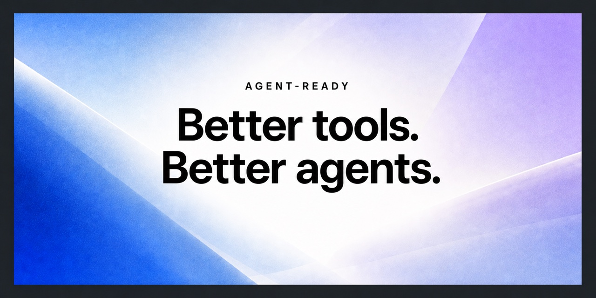

<h1 align="center">agent-ready</h1>

<p align="center"><strong>Give AI coding agents the right command-line tools, and teach them when to use each one.</strong></p>

<p align="center">
  One command sets up Claude Code, Codex, Cursor, Gemini CLI, GitHub Copilot CLI,
  Windsurf, and ten more agents on macOS, Linux, and WSL2.
</p>

<p align="center">
  
  
  <a href="https://github.com/Dankosik/agent-ready/actions/workflows/ci.yml"></a>
  
  
</p>

<p align="center">
  
</p>

<p align="center">
  <a href="#quick-start">Quick start</a> ·
  <a href="#what-gets-added-to-agentsmd">AGENTS.md example</a> ·
  <a href="#supported-agents">Agents</a> ·
  <a href="#whats-installed">Tools</a> ·
  <a href="#go-support">Go</a> ·
  <a href="#update">Update</a> ·
  <a href="#uninstall">Uninstall</a> ·
  <a href="#faq">FAQ</a>
</p>

## What is agent-ready?

AI coding agents work through the shell. Left alone, they reach for the
commands they already know: `grep` instead of `rg`, `cat` on a whole file
instead of reading one section, `sed` for structural code edits, raw build
output that floods the context window. Installing better tools does not change
that on its own; measured on real session transcripts, an agent keeps using
its defaults unless something tells it otherwise.

`agent-ready` does both halves of the job:

1. **Installs a CLI toolkit for agents.** 17 language-independent tools for
   search, structural edits, compact output, data, Git, code intelligence, and
   local security checks (see [What's installed](#whats-installed)).
2. **Teaches every agent to use it.** It writes a short, versioned block of
   *tool routing* rules into each agent's global instruction file, such as
   `~/.codex/AGENTS.md` or `~/.claude/CLAUDE.md`. Every new session starts with
   those rules, so the agent picks `rg`, `ast-grep`, `jq`, or `codegraph` for
   the right job. You can [read the exact block](#what-gets-added-to-agentsmd)
   below.

Everything outside that block stays yours. The installer preserves existing
content, verifies every download, never uses `sudo`, and can be removed with
one command.

## Quick start

Requires at least one supported coding agent, and:

- macOS: [Homebrew](https://brew.sh/)
- Linux or [WSL2](https://learn.microsoft.com/en-us/windows/wsl/install):
  `curl`, `xz`, and `unzip`. No Homebrew and no root needed; see
  [Linux without Homebrew](#linux-without-homebrew).

On Debian or Ubuntu:

```bash
sudo apt-get install -y curl ca-certificates xz-utils unzip
```

Then run:

```bash
curl -fsSL https://raw.githubusercontent.com/Dankosik/agent-ready/v1.5.1/bootstrap.sh | AGENT_READY_REF=v1.5.1 bash
```

That's it. The installer adds the tools and configures every
[supported agent](#supported-agents) it finds on this machine. Start a new agent
session after the command finishes.

What happens during that command:

1. `bootstrap.sh` downloads the `v1.5.1` release archive and checks it against
   the SHA-256 digest GitHub records before anything inside it runs.
2. The installer detects which agents are on this machine.
3. It installs missing tools (with Homebrew on macOS, from verified GitHub
   release binaries on Linux). Tools you already have are not upgraded.
4. It writes the routing block into each detected agent's instruction file and
   wires the CodeGraph MCP server through `codegraph install`.
5. It records what it configured in a receipt and leaves an
   [`agent-ready` command](#the-agent-ready-command) for updates and removal.

On macOS it also installs GNU coreutils, because agents call `timeout` by reflex
and macOS has none. If no `timeout` is on your `PATH`, the installer links
`~/.local/bin/timeout` to `gtimeout`; it never replaces a file already there.

The command is pinned to the immutable `v1.5.1` release. Upgrade with
[`agent-ready update`](#update), or by choosing a newer release version in both
places in the command.

> [!NOTE]
> `agent-ready` configures coding agents but does not install them or sign in to
> their services.

On Windows, run the installer inside WSL2. It configures agents installed in the
same WSL environment; native Windows is not supported.

For best performance, keep repositories used by Linux agents in the WSL
filesystem, such as `~/projects`, rather than under `/mnt/c`.

## What gets added to AGENTS.md

This is the exact block a `v1.5.1` install writes into an agent's global
instruction file, here `~/.config/goose/AGENTS.md`. Codex gets the same block in
`~/.codex/AGENTS.md`, Claude Code in `~/.claude/CLAUDE.md`, and so on (see
[Supported agents](#supported-agents)). Nothing above or below the markers is
touched.

```markdown
<!-- agent-ready:start -->
<!-- agent-ready v1.5.1 sha256:9a75b89a66e657a538aadf5ab76459ab171e17201a53c5b78c176ca160b4189b -->
Tool routing (use instead of defaults):
- Shell: prefix commands with `rtk`; `rtk bypass <cmd>` for unfiltered output.
- Builds/tests: don't pipe them into `tail`/`head`; the pipe exits 0 and cuts the failure. rtk already condenses cargo/go/pytest/vitest/tsc output; if you must trim, `set -o pipefail` first.
- Literal multi-line edits: use your file-edit tool, which fails when the text is missing; a script's `str.replace` and `sd` silently change nothing, so check the match count.
- Search: `rg` text, `rg --files` files; code structure (calls, declarations, loops, branches): `ast-grep run -l <lang> -p '<pattern>'` (`$X` matches any node; add `-r '<new>' -U` to rewrite), even where a regex fits.
- Edit: `sd -F 'old' 'new' <file>` (literal, in place; drop `-F` for regex); temporary Python deps: `uv run --with <pkg>`.
- Data: `jq` JSON, `yq` YAML/TOML/XML (`yq -i` edits these and JSON in place), `gh api --jq` GitHub.
- Worktrees: `wt list` first, then Worktrunk (`wt switch -c <branch>`); `wt <cmd> --help` before mutating.
- Read: `mdq '# <heading>' <file>` to read one section of a long Markdown file instead of all of it.
- Diffs: when formatting noise may hide a logic change, `git -c diff.external='difft --display inline' diff` (without `rtk`).
- Check: `shellcheck` shell, `actionlint` workflows, `gitleaks dir|git --redact .` files|history, `osv-scanner scan source -r .` vulnerable dependencies.
- Timing: to compare commands, `hyperfine --warmup 3 '<a>' '<b>'`, not single `time` runs.
- Code graph: index of symbols, calls, imports. With `.codegraph/`, first ask `codegraph_explore` (MCP) or `codegraph explore "<question>"` how code works, who calls what, what a change affects; its source is current, so do not re-read it, but a file marked changed since sync may have stale callers (`codegraph sync`). No index: normal routing; never `codegraph init` unasked.
<!-- agent-ready:end -->
```

How to read it:

- **Markers.** `agent-ready:start` and `agent-ready:end` fence the managed
  block. Reruns, updates, and uninstall touch only what is between them.
- **Header.** The second line records the release that wrote the block and a
  SHA-256 fingerprint of its body. If you edit inside the markers, the next run
  notices the mismatch and stops instead of overwriting your change.
- **Rules.** One line per job: which tool to use, the one flag that matters,
  and the trap it avoids. The full manuals stay in each tool's `--help`, where
  they cost no context until needed.

The block varies slightly by setup:

- For Claude Code, Codex, Gemini CLI, and OpenCode, the `Code graph:` line is
  left out when `codegraph` is installed, because CodeGraph writes its own
  marker-fenced section for those agents and the rule would otherwise repeat.
- With [Go support](#go-support), one more line is appended:

  ```markdown
  - Go: use gopls where compiler semantics matter: `go_symbol_references` before renames, removals, signature changes, or interface-method changes; `go_diagnostics` after cross-file, type, or import changes; and `go_vulncheck` after dependency changes or for security work. Use `go_workspace` only when the module/workspace layout is unclear; otherwise follow the normal routing and finish with Go tests. These are gopls MCP tools; where they are not available, use `gopls references <file>:<line>:<col>` and `gopls check <file>` instead.
  ```

- Cursor has no global instruction file, so it gets the same text through a
  session-start hook in `~/.cursor/hooks.json`.

The source of the block is [`agent-routing.md`](agent-routing.md) (and
[`languages/go/agent-routing.md`](languages/go/agent-routing.md) for Go).

## Supported agents

Automatic detection configures every agent below whose command (or, for Cursor,
Windsurf / Devin Desktop, and Google Antigravity, app bundle) it finds. To
configure only one, pass its selector:

```bash
curl -fsSL https://raw.githubusercontent.com/Dankosik/agent-ready/v1.5.1/bootstrap.sh | AGENT_READY_REF=v1.5.1 bash -s -- codex
```

| Agent | Selector | Where the routing goes |
|---|---|---|
| Claude Code | `claude` | `~/.claude/CLAUDE.md` |
| Codex | `codex` | `~/.codex/AGENTS.md`, or a non-empty `AGENTS.override.md` there |
| Cursor | `cursor` | global hook in `~/.cursor/hooks.json` |
| Gemini CLI | `gemini` | `~/.gemini/GEMINI.md` (under `GEMINI_CLI_HOME` when set) |
| Google Antigravity | `antigravity` | `~/.gemini/GEMINI.md` (shared with Gemini CLI) |
| GitHub Copilot CLI | `copilot` | `~/.copilot/copilot-instructions.md` |
| Windsurf / Devin Desktop | `windsurf` | `~/.devin/global_rules.md`, or `~/.codeium/windsurf/memories/global_rules.md` on a machine with only the older app's data |
| Grok Build | `grok` | `~/.grok/rules/agent-ready.md` |
| OpenCode | `opencode` | `~/.config/opencode/AGENTS.md` (`OPENCODE_CONFIG_DIR` when set), or `~/.claude/CLAUDE.md` when OpenCode 1.x already loads that |
| Qwen Code | `qwen` | `~/.qwen/QWEN.md` |
| Cline CLI | `cline` | `~/.cline/rules/agent-ready.md` |
| Kilo Code | `kilo` | `~/.config/kilo/AGENTS.md` (`KILO_CONFIG_DIR` when set), or `~/.claude/CLAUDE.md` when Kilo already loads that |
| Crush | `crush` | `~/.config/crush/CRUSH.md` (`CRUSH_GLOBAL_CONFIG` when set) |
| goose | `goose` | `~/.config/goose/AGENTS.md` (`GOOSE_PATH_ROOT/config` when set) |
| DeepSeek Harness | `dsh` | `~/.dsh/AGENTS.md` |
| Pi | `pi` | `~/.pi/agent/AGENTS.md`, or the context file Pi already loads there |

Several agents at once take a comma list, for example
`bash -s -- --agent claude,codex`. OpenCode plugins use OpenCode's
instructions. Kilo Code is configured separately because its OpenCode-based CLI
uses its own config directory. DeepSeek Harness runs through `npx`, so it is also
detected by its `~/.dsh` directory. Pi loads only the first context file it finds
in its agent directory, so the block joins an existing `AGENTS.override.md` or
`CLAUDE.md` rather than hide it behind a new `AGENTS.md`. Kilo Code loads the
first of its `AGENTS.md` and `~/.claude/CLAUDE.md` that exists, so the block joins
that `CLAUDE.md` for the same reason, and the installer points out a Kilo file that
holds nothing of yours but still hides it. After Kilo's Claude migration it no
longer loads that `CLAUDE.md`, and `KILO_CONFIG_DIR` replaces its default directory,
so the block follows both. OpenCode 1.x follows the same first-match rule, so it
gets the same treatment. `codegraph install` would create the `AGENTS.md` that hides
`CLAUDE.md`, so that one case skips the CodeGraph MCP entry for OpenCode and keeps
the CLI routing. OpenCode 2.x reads only its `AGENTS.md`. Codex likewise reads a
non-empty `AGENTS.override.md` instead of `AGENTS.md`. When the file an agent
loads changes, the next run moves the block there, and uninstall removes a block
from either file. A block in the older Windsurf file stays until uninstall,
because that app may still be in use alongside `~/.devin`.

## What's installed

| Job | Tools | Why an agent needs it |
|---|---|---|
| Code intelligence | [`codegraph`](https://github.com/colbymchenry/codegraph) | Answers "how does this work, who calls it, what breaks" in one call instead of a grep-and-read loop |
| Compact output | [`rtk`](https://github.com/rtk-ai/rtk) | Condenses shell, build, and test output so it does not flood the context window |
| Search and edit | [`ripgrep`](https://github.com/BurntSushi/ripgrep), [`ast-grep`](https://ast-grep.github.io/), [`sd`](https://github.com/chmln/sd) | Fast text search, syntax-aware code search and rewrite, predictable find-and-replace |
| Python and data | [`uv`](https://docs.astral.sh/uv/), [`jq`](https://jqlang.org/), [`yq`](https://mikefarah.gitbook.io/yq/), [`mdq`](https://github.com/yshavit/mdq) | Throwaway Python dependencies, JSON/YAML/TOML queries and edits, reading one Markdown section |
| Git and GitHub | [`gh`](https://cli.github.com/), [`worktrunk`](https://worktrunk.dev/), [`difftastic`](https://difftastic.wilfred.me.uk/) | GitHub API and PRs, isolated worktrees, diffs that ignore formatting noise |
| Local checks | [`gitleaks`](https://github.com/gitleaks/gitleaks), [`osv-scanner`](https://google.github.io/osv-scanner/), [`actionlint`](https://github.com/rhysd/actionlint), [`shellcheck`](https://www.shellcheck.net/), [`hyperfine`](https://github.com/sharkdp/hyperfine) | Secrets, vulnerable dependencies, workflow and shell linting, honest benchmarks |
| Command time limits (macOS) | [`coreutils`](https://www.gnu.org/software/coreutils/) (`timeout`) | Agents call `timeout` by reflex; macOS ships none |

The generic installer and language installers are separate. Adding Go support
does not change the base tool list.

### Linux without Homebrew

On Linux, the tools come from each project's latest GitHub release, not from a
package manager:

- every download is checked against the SHA-256 digest GitHub records for that
  release asset before it is unpacked; a mismatch installs nothing;
- binaries go to `~/.local/bin` (override with `AGENT_READY_BIN_DIR`), so no
  `sudo` is needed, and it also works as root in a container;
- static builds are used where upstream publishes them; `mdq` publishes no
  arm64 Linux build and is skipped there;
- if the latest release lacks the Linux build (for example, its upstream build
  failed), the newest stable release among the last 30 that has it is used, and
  the installer says which one.

If Homebrew is already installed, it is used as before. Pass `--binaries` to use
release binaries anyway. Add `~/.local/bin` to `PATH` if the installer says it
is missing. Go support builds `gopls` with your Go toolchain
(`go install golang.org/x/tools/gopls@latest`) into the same directory.

The installer makes one GitHub API request per tool it installs. If you hit the
anonymous rate limit, set `GITHUB_TOKEN` and run it again.

## Code intelligence with CodeGraph

`codegraph` builds a local knowledge graph of a repository and answers
structural questions from it — the source of the symbols involved, the call
paths between them, and what a change would touch — instead of making the agent
grep and read files one at a time.

The graph is per project. Agent Ready installs the CLI; it does not index your
repositories. Run this once in each project you want covered:

```bash
cd your-project
codegraph init
```

That creates a local `.codegraph/` index; a running MCP server keeps it current
as you edit. Without an MCP connection — for example an agent CodeGraph does not
support — run `codegraph sync` after edits to refresh its symbol list; `explore`
still reads the source from disk. Add `.codegraph/` to `.gitignore` rather than
committing it. The routing rule uses the index only when that directory exists.
Without one, the agent keeps using `rg`, `ast-grep`, and `Read`, and does not
run `codegraph init` on its own.

<details>
<summary>How CodeGraph is installed and wired</summary>

Upstream publishes no Homebrew formula, so it is installed from its release
archive on macOS and Linux alike — about 60 MB to download and 280 MB unpacked
on the first run; later runs reuse the recorded release. Because that archive is
a self-contained bundle:

- the SHA-256 digest GitHub records for the asset is checked before unpacking;
- versions live under `~/.local/share/agent-ready/codegraph/versions/`, and
  only the launcher is linked into `~/.local/bin` (or `AGENT_READY_BIN_DIR`);
- `--upgrade` updates that copy and prunes older versions; a `codegraph`
  installed with npm or upstream's script is not replaced (MCP wiring and
  telemetry still apply);
- anonymous usage telemetry stays off during the wiring and is then turned off
  for good, so nothing is reported. Re-enable it with `codegraph telemetry on`.

MCP wiring is delegated to CodeGraph's own installer, which knows each agent's
config shape. Automatic installation passes `--target=auto`, so CodeGraph wires
every agent it detects; an explicit `--agent` passes that agent's target. The
command is `codegraph install --yes --target=… --location=global
--no-permissions`, which merges the MCP server entry, may add CodeGraph's own
marker-fenced section to the agent's instruction file, and (for Claude Code)
adds its prompt hook in `settings.json`. CodeGraph writes that section for
Claude Code, Codex, Gemini CLI, and OpenCode, so when `codegraph` is installed
their agent-ready block leaves out its own CodeGraph line rather than repeat the
same rule in every prompt. Other agents keep the line and get the CLI routing.
Google Antigravity shares Gemini CLI's file, so it drops the line only when Gemini
is configured too or the install is automatic. CodeGraph's Antigravity target
configures the desktop app; the `agy` CLI uses the CLI routing.

`codegraph install` writes a config by renaming a new file over it, which would
turn a dotfiles symlink into a plain copy. The installer remembers the symlinks
in those agents' directories, moves the new content to the link's target, and
puts the link back. Running `codegraph install` or `codegraph uninstall` by hand
has no such protection.

</details>

## Go support

Run this after the quick start command if you work with Go:

```bash
curl -fsSL https://raw.githubusercontent.com/Dankosik/agent-ready/v1.5.1/bootstrap.sh | AGENT_READY_REF=v1.5.1 bash -s -- language go
```

It installs `gopls`, connects `gopls mcp` to detected Codex, Claude Code, and
Cursor installations, and adds the [Go routing line](#what-gets-added-to-agentsmd).
After an install that named its agents, it stays with those agents instead of
detecting more.

<details>
<summary>Configure Go for one agent</summary>

```bash
# Codex
curl -fsSL https://raw.githubusercontent.com/Dankosik/agent-ready/v1.5.1/bootstrap.sh | AGENT_READY_REF=v1.5.1 bash -s -- language go --agent codex

# Claude Code
curl -fsSL https://raw.githubusercontent.com/Dankosik/agent-ready/v1.5.1/bootstrap.sh | AGENT_READY_REF=v1.5.1 bash -s -- language go --agent claude

# Cursor
curl -fsSL https://raw.githubusercontent.com/Dankosik/agent-ready/v1.5.1/bootstrap.sh | AGENT_READY_REF=v1.5.1 bash -s -- language go --agent cursor
```

</details>

## Safe to run again

The installers preserve existing configuration and update only the block
between the `agent-ready:start` and `agent-ready:end` markers. Cursor hooks and
MCP configuration are merged instead of replaced.

Each managed block starts with a `<!-- agent-ready vX.Y.Z sha256:… -->` line
that records the release which wrote it and fingerprints the block. If you edit
inside the markers, the next run stops before changing any file and names it;
move the edit outside the markers, or rerun with `--force` to replace the
block. `--dry-run` performs the same detection and checks and reports
`would add`, `would refresh`, `unchanged`, or `blocked` for every target
without installing tools, invoking `rtk` or `codegraph`, or modifying any file.
The installer also records the agents, languages, tool method, and version it
configured in `~/.config/agent-ready/receipt` (or under `$XDG_CONFIG_HOME`).

Release archives are checked against the SHA-256 digest GitHub records for the
`agent-ready-vX.Y.Z.tar.gz` asset before anything inside them runs, and a release
that publishes no such asset is refused. When `gh` is installed and signed in,
the build provenance of the archive is verified too.

Run the same command again whenever you want to refresh the managed
configuration. Installed tools are not upgraded unless you pass `--upgrade`;
with release binaries, `--upgrade` downloads only the tools that have a newer
release, and CodeGraph is upgraded only when Agent Ready installed it. Use
`--configure-only` to skip tool installation entirely:

```bash
curl -fsSL https://raw.githubusercontent.com/Dankosik/agent-ready/v1.5.1/bootstrap.sh | AGENT_READY_REF=v1.5.1 bash -s -- codex --configure-only
```

To explicitly upgrade the generic tools:

```bash
curl -fsSL https://raw.githubusercontent.com/Dankosik/agent-ready/v1.5.1/bootstrap.sh | AGENT_READY_REF=v1.5.1 bash -s -- --upgrade
```

## Update

`agent-ready update` moves the installed command and the configuration it
manages to the newest release, repeating the install recorded in the receipt:

```bash
agent-ready update           # newest release that is at least 24 hours old
agent-ready update --check   # only report; exits 10 when an update is available
agent-ready update vX.Y.Z    # an explicit release, including a downgrade
```

It repeats the receipt's agents, languages, and tool mode, so an agent you did
not select is never configured and a configure-only install stays
configure-only. Tools are not upgraded unless you pass `--upgrade-tools`.
`--dry-run` runs the new release's installer in dry-run mode and writes
nothing, and `--force` is passed through for a block whose local edits would
otherwise stop the update.

A release is only offered once its archive has been published for 24 hours, so
a broken release can be withdrawn before anyone updates to it; set
`AGENT_READY_MIN_RELEASE_AGE` to a number of hours to change that, or to `0` to
take the newest release immediately. The archive is verified against the
SHA-256 digest GitHub records before anything inside it runs. An install from
v1.3.0 or earlier has no receipt; `update` then assumes automatic agent
detection and reads the tool mode from the machine, and says so.

After the update, start a new agent session to load the updated instructions.
`agent-ready rollback` returns to the previous release when the update is not
what you wanted.

## Uninstall

`agent-ready uninstall` removes the configuration agent-ready wrote and nothing
else:

```bash
agent-ready uninstall           # remove managed configuration and state
agent-ready uninstall --dry-run # report the plan and change nothing
agent-ready uninstall --force   # remove a block that has local edits
```

It targets every agent in the receipt's `configured` list or, without a receipt,
every instruction file that still carries agent-ready markers. For each one it
removes only the block between `agent-ready:start` and `agent-ready:end`; Cursor
loses only its entry in `~/.cursor/hooks.json` and
`~/.cursor/hooks/agent-ready-session-start.json`. It then removes the receipt,
`~/.config/agent-ready/languages/`, the launcher only when it is agent-ready's
own symlink, and `~/.local/share/agent-ready/versions/`. A file agent-ready
created is left in place (empty) rather than deleted, and a block with local
edits stops the run and is named unless you pass `--force`.

Installed tools are not removed. The command lists what is still installed and
prints the exact removal commands, including `rtk init -g --uninstall` for the
RTK integration and `codegraph uninstall` for the CodeGraph MCP wiring; those
belong to those tools. rtk 1.1.0 deletes the whole `~/.gemini/GEMINI.md` when it
removes its Gemini integration, so the Gemini command keeps a copy and restores
it. After Go support, the list also names the `gopls` MCP entries to remove. The
`binaries` and `codegraph` state files stay while the tools they describe are
installed. From a checkout, `./install.sh --uninstall` does the same.

Installs, updates, and uninstalls refuse a read-only instruction file before
writing anything, unless the file needs no change.

## The `agent-ready` command

Installing from a release also leaves a local `agent-ready` command, laid out
like the CodeGraph bundle: every version keeps its own tree, and only a launcher
is on `PATH`.

```text
${XDG_DATA_HOME:-$HOME/.local/share}/agent-ready/versions/vX.Y.Z/
${AGENT_READY_BIN_DIR:-$HOME/.local/bin}/agent-ready -> .../versions/vX.Y.Z/agent-ready
```

An install keeps the version it installed and the one before it and removes
older trees. A launcher you already have is kept unless this installer created
it. The command takes the same arguments as the bootstrap, without downloading
anything:

```bash
agent-ready                        # install with automatic detection
agent-ready codex                  # configure one agent
agent-ready --agent claude,codex   # configure a comma list
agent-ready language go            # add Go support
agent-ready status                 # tree, launcher, receipt, and drift
agent-ready doctor                 # ok/problem for the install and every tool
agent-ready update                 # move to the newest release
agent-ready rollback               # reinstall the newest kept older release
agent-ready uninstall              # remove only what agent-ready wrote
```

`status` prints the installed version, the launcher target, the receipt fields,
the kept versions, and what this tree's installer would change. The drift check
repeats the receipt's agents as one `--agent` list and the receipt's tool mode,
so a machine installed with `--configure-only` is compared with `--configure-only`.
`doctor` reports each check as `ok` or `problem` and exits non-zero when
anything fails; `mdq` is only warned about because upstream publishes no arm64
Linux build. Neither `status` nor `doctor` writes anything or uses the network.

A rollback or a named downgrade to a release that predates an agent drops that
agent from the receipt and leaves its routing block in place until a newer
release. If the older release cannot run, the receipt is restored.

`rollback` is offline too. It finds the newest kept version below the receipt's
and reruns that tree's installer with the receipt's agents, so the managed
blocks and the receipt go back to that release; because an install keeps only
two versions, it can go back one release.

The local command appears after an install from a release. A checkout, a
development ref, or an `AGENT_READY_ARCHIVE_URL` archive runs the requested
install but does not install the command.

## Verify

Quick check:

```bash
agent-ready doctor
rtk --version
rg --version
ast-grep --version
codegraph version
```

<details>
<summary>Run the full local verification</summary>

```bash
git clone https://github.com/Dankosik/agent-ready.git
cd agent-ready

./verify.sh
./test-install.sh
./languages/go/verify.sh # after installing Go support
```

`verify.sh` reproduces every claim about the tools in this README on your
machine. `verify.sh` and `test-install.sh` use temporary fixtures and do not
edit your real agent configuration.

</details>

## FAQ

<details>
<summary><strong>Does it replace my AGENTS.md or CLAUDE.md?</strong></summary>

No. It adds one marker-fenced block and leaves the rest of the file as it was.
If the file does not exist, it is created with only that block. Edits you make
inside the markers stop the next run instead of being overwritten.

</details>

<details>
<summary><strong>Does it install Claude Code, Codex, or other agents?</strong></summary>

No. It configures agents that are already installed and does not sign in to
their services. Install your agent first, then run agent-ready.

</details>

<details>
<summary><strong>Will it upgrade tools I already have?</strong></summary>

No. Existing tools are kept at their current version. Upgrades happen only with
`--upgrade` (or `agent-ready update --upgrade-tools`).

</details>

<details>
<summary><strong>Does it need sudo or root?</strong></summary>

No. On macOS it uses your Homebrew; on Linux it installs into `~/.local/bin`.
The only `sudo` in this README is the optional `apt-get` line for `curl`,
`xz`, and `unzip`.

</details>

<details>
<summary><strong>Can I change the routing rules?</strong></summary>

Yes. Put your own rules outside the markers; the installer never touches them.
To change a managed line, edit it and pass `--force` on the next run, which
replaces the block with the release's version, or open an issue so the rule is
fixed for everyone.

</details>

<details>
<summary><strong>Can I preview the changes first?</strong></summary>

Yes. Add `--dry-run` to any base install, update, or uninstall command. It reports
`would add`, `would refresh`, `unchanged`, or `blocked` for every file and
writes nothing. `language go` has no dry run, because its setup changes each
agent's own MCP configuration through that agent's CLI.

</details>

## Troubleshooting

<details>
<summary><code>Homebrew is required</code></summary>

This applies to macOS. Install Homebrew from [brew.sh](https://brew.sh/), open a
new terminal, and check that `brew --version` works.

</details>

<details>
<summary><code>missing: xz unzip</code></summary>

Install the packages the error names with your distribution's package manager;
the error prints the command for Debian/Ubuntu, Fedora/RHEL, and Alpine. Nothing
was downloaded yet.

</details>

<details>
<summary><code>GitHub API rate limit reached</code></summary>

Anonymous GitHub API requests are limited per IP address, which shared CI
runners and offices hit quickly. Set `GITHUB_TOKEN` (any token works; no scopes
are needed) and run the installer again. Already installed tools are skipped.

</details>

<details>
<summary><code>checksum mismatch</code></summary>

The downloaded file does not match the digest GitHub records for the release
asset, so it was not installed. Run the installer again; if it persists, report
it to the tool's project.

</details>

<details>
<summary><code>No supported harness found</code></summary>

Install your coding agent or choose it explicitly from the
[agent list](#supported-agents).

</details>

<details>
<summary><code>malformed agent-ready markers</code></summary>

Open the file printed in the error. It must contain either no agent-ready
markers or one start marker followed by one end marker. Fix duplicate or
unmatched markers and run the installer again.

</details>

<details>
<summary><code>has local edits inside the agent-ready block</code></summary>

Someone edited the managed block, so its fingerprint no longer matches. Move
your edit outside the markers and rerun, or rerun with `--force` to replace the
block with the release's version.

</details>

<details>
<summary><code>Cursor MCP config is not valid JSON</code></summary>

Fix the JSON in `~/.cursor/mcp.json`, then run the Go installer again. The
installer leaves an invalid file unchanged.

</details>

<details>
<summary><code>codegraph: command not found after installation</code></summary>

The launcher is linked into `~/.local/bin` (or `AGENT_READY_BIN_DIR`). Add that
directory to `PATH` in your shell profile and open a new terminal. The MCP
configuration uses the `codegraph` name, so the server cannot start until the
command resolves.

</details>

<details>
<summary><code>CodeGraph isn't available here</code></summary>

The project has no `.codegraph/` index. Run `codegraph init` in the repository
root once; a running MCP server picks the new index up without a restart. The
installer does not index repositories; the routing rule deliberately leaves
that decision to you.

On WSL with the repository on a Windows drive, CodeGraph keeps its index in
`.codegraph-wsl/` instead; the command still works there.

</details>

## Project scope

- macOS with Homebrew; Linux with release binaries or Homebrew. CI covers macOS,
  Ubuntu on x86_64 and arm64, and a root-only Ubuntu container, and reruns daily
  against the latest tool releases
- Windows through WSL2; CI smoke-tests Ubuntu on WSL2, while native Windows is
  unsupported
- language-independent tools in the root installer, including CodeGraph, which
  comes from its release bundle because upstream publishes no formula
- language integrations under `languages/<name>/`
- runnable verification for every included tool

Contributions follow [`AGENTS.md`](AGENTS.md). Report security issues privately
as described in [`SECURITY.md`](SECURITY.md).

## License

[MIT](LICENSE)
