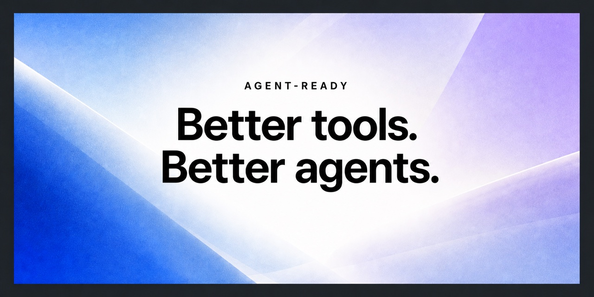

<h1 align="center">agent-ready</h1>

<p align="center"><strong>Reliable command-line tools for AI coding agents on macOS and Linux.</strong></p>

<p align="center">
  
  
  <a href="https://github.com/Dankosik/agent-ready/actions/workflows/ci.yml"></a>
  
</p>

<p align="center">
  
</p>

<p align="center">
  <a href="#quick-start">Quick start</a> ·
  <a href="#install-for-one-agent">Agents</a> ·
  <a href="#go-support">Go</a> ·
  <a href="#whats-installed">Tools</a> ·
  <a href="#verify">Verify</a>
</p>

`agent-ready` installs a practical CLI toolkit and adds the instructions that
help coding agents use it correctly.

## Quick start

Requires at least one supported coding agent, and:

- macOS: [Homebrew](https://brew.sh/)
- Linux or [WSL2](https://learn.microsoft.com/en-us/windows/wsl/install):
  `curl`, `xz`, and `unzip`. No Homebrew and no root needed; see
  [Linux without Homebrew](#linux-without-homebrew).

On Debian or Ubuntu:

```bash
sudo apt-get install -y curl ca-certificates xz-utils unzip
```

```bash
curl -fsSL https://raw.githubusercontent.com/Dankosik/agent-ready/v1.0.2/bootstrap.sh | AGENT_READY_REF=v1.0.2 bash
```

That's it. The installer adds 15 language-independent tools and configures
Claude Code, Codex, Cursor, Gemini CLI, GitHub Copilot CLI, and Windsurf when it
finds them. Start a new agent session after the command finishes.

The command is pinned to the immutable `v1.0.2` release. Upgrade by choosing a
newer release version in both places in the command.

> [!NOTE]
> `agent-ready` configures coding agents but does not install them or sign in to
> their services.

On Windows, run the installer inside WSL2. It configures agents installed in the
same WSL environment; native Windows is not supported.

For best performance, keep repositories used by Linux agents in the WSL
filesystem, such as `~/projects`, rather than under `/mnt/c`.

### Linux without Homebrew

On Linux, the tools come from each project's latest GitHub release, not from a
package manager:

- every download is checked against the SHA-256 digest GitHub records for that
  release asset before it is unpacked; a mismatch installs nothing;
- binaries go to `~/.local/bin` (override with `AGENT_READY_BIN_DIR`), so no
  `sudo` is needed, and it also works as root in a container;
- static builds are used where upstream publishes them; `mdq` publishes no
  arm64 Linux build and is skipped there.

If Homebrew is already installed, it is used as before. Pass `--binaries` to use
release binaries anyway. Add `~/.local/bin` to `PATH` if the installer says it
is missing. Go support builds `gopls` with your Go toolchain
(`go install golang.org/x/tools/gopls@latest`) into the same directory.

The installer makes one GitHub API request per tool it installs. If you hit the
anonymous rate limit, set `GITHUB_TOKEN` and run it again.

## Install for one agent

Use one of these commands if you want to configure a specific agent instead of
automatic detection.

<details>
<summary><strong>Codex</strong></summary>

```bash
curl -fsSL https://raw.githubusercontent.com/Dankosik/agent-ready/v1.0.2/bootstrap.sh | AGENT_READY_REF=v1.0.2 bash -s -- codex
```

Routing is added to `~/.codex/AGENTS.md`.

</details>

<details>
<summary><strong>Claude Code</strong></summary>

```bash
curl -fsSL https://raw.githubusercontent.com/Dankosik/agent-ready/v1.0.2/bootstrap.sh | AGENT_READY_REF=v1.0.2 bash -s -- claude
```

Routing is added to `~/.claude/CLAUDE.md`.

</details>

<details>
<summary><strong>Cursor</strong></summary>

```bash
curl -fsSL https://raw.githubusercontent.com/Dankosik/agent-ready/v1.0.2/bootstrap.sh | AGENT_READY_REF=v1.0.2 bash -s -- cursor
```

Routing is added through the global hook in `~/.cursor/hooks.json`.

</details>

<details>
<summary><strong>Gemini CLI</strong></summary>

```bash
curl -fsSL https://raw.githubusercontent.com/Dankosik/agent-ready/v1.0.2/bootstrap.sh | AGENT_READY_REF=v1.0.2 bash -s -- gemini
```

Routing is added to `~/.gemini/GEMINI.md`.

</details>

<details>
<summary><strong>GitHub Copilot CLI</strong></summary>

```bash
curl -fsSL https://raw.githubusercontent.com/Dankosik/agent-ready/v1.0.2/bootstrap.sh | AGENT_READY_REF=v1.0.2 bash -s -- copilot
```

Routing is added to `~/.copilot/copilot-instructions.md`.

</details>

<details>
<summary><strong>Windsurf</strong></summary>

```bash
curl -fsSL https://raw.githubusercontent.com/Dankosik/agent-ready/v1.0.2/bootstrap.sh | AGENT_READY_REF=v1.0.2 bash -s -- windsurf
```

Routing is added to `~/.codeium/windsurf/memories/global_rules.md`.

</details>

### Additional agents in the current checkout

Run `./bootstrap.sh opencode --configure-only` from a checkout, replacing
`opencode` with the selector you need:

| Agent | Selector | Global instructions |
|---|---|---|
| Grok Build | `grok` | `~/.grok/rules/agent-ready.md` |
| OpenCode | `opencode` | `~/.config/opencode/AGENTS.md` |
| Qwen Code | `qwen` | `~/.qwen/QWEN.md` |
| Cline CLI | `cline` | `~/.cline/data/settings/rules/agent-ready.md` |
| Kilo Code | `kilo` | `~/.config/kilo/AGENTS.md` |
| Crush | `crush` | `~/.config/crush/CRUSH.md` |
| goose | `goose` | `~/.config/goose/AGENTS.md` |

OpenCode plugins use OpenCode's instructions. Kilo Code is configured
separately because its OpenCode-based CLI uses its own config directory.

## Go support

Run this after the quick start command if you work with Go:

```bash
curl -fsSL https://raw.githubusercontent.com/Dankosik/agent-ready/v1.0.2/bootstrap.sh | AGENT_READY_REF=v1.0.2 bash -s -- language go
```

It installs `gopls`, connects `gopls mcp` to detected Codex, Claude Code, and
Cursor installations, and adds the Go routing instructions.

<details>
<summary>Configure Go for one agent</summary>

```bash
# Codex
curl -fsSL https://raw.githubusercontent.com/Dankosik/agent-ready/v1.0.2/bootstrap.sh | AGENT_READY_REF=v1.0.2 bash -s -- language go --agent codex

# Claude Code
curl -fsSL https://raw.githubusercontent.com/Dankosik/agent-ready/v1.0.2/bootstrap.sh | AGENT_READY_REF=v1.0.2 bash -s -- language go --agent claude

# Cursor
curl -fsSL https://raw.githubusercontent.com/Dankosik/agent-ready/v1.0.2/bootstrap.sh | AGENT_READY_REF=v1.0.2 bash -s -- language go --agent cursor
```

</details>

## What's installed

| Job | Tools |
|---|---|
| Compact output | [`rtk`](https://github.com/rtk-ai/rtk) |
| Search and edit | [`ripgrep`](https://github.com/BurntSushi/ripgrep), [`ast-grep`](https://ast-grep.github.io/), [`sd`](https://github.com/chmln/sd) |
| Python and data | [`uv`](https://docs.astral.sh/uv/), [`jq`](https://jqlang.org/), [`yq`](https://mikefarah.gitbook.io/yq/), [`mdq`](https://github.com/yshavit/mdq) |
| Git and GitHub | [`gh`](https://cli.github.com/), [`worktrunk`](https://worktrunk.dev/), [`difftastic`](https://difftastic.wilfred.me.uk/) |
| Local checks | [`gitleaks`](https://github.com/gitleaks/gitleaks), [`actionlint`](https://github.com/rhysd/actionlint), [`shellcheck`](https://www.shellcheck.net/), [`hyperfine`](https://github.com/sharkdp/hyperfine) |

The generic installer and language installers are separate. Adding Go support
does not change the base tool list.

## Safe to run again

The installers preserve existing configuration and update only the block
between the `agent-ready:start` and `agent-ready:end` markers. Cursor hooks and
MCP configuration are merged instead of replaced.

Run the same command again whenever you want to refresh the managed
configuration. Installed tools are not upgraded unless you pass `--upgrade`;
with release binaries, `--upgrade` downloads only the tools that have a newer
release. Use `--configure-only` to skip tool installation entirely:

```bash
curl -fsSL https://raw.githubusercontent.com/Dankosik/agent-ready/v1.0.2/bootstrap.sh | AGENT_READY_REF=v1.0.2 bash -s -- codex --configure-only
```

To explicitly upgrade the generic tools:

```bash
curl -fsSL https://raw.githubusercontent.com/Dankosik/agent-ready/v1.0.2/bootstrap.sh | AGENT_READY_REF=v1.0.2 bash -s -- --upgrade
```

## Verify

Quick check:

```bash
rtk --version
rg --version
ast-grep --version
```

<details>
<summary>Run the full local verification</summary>

```bash
git clone https://github.com/Dankosik/agent-ready.git
cd agent-ready

./verify.sh
./test-install.sh
./languages/go/verify.sh # after installing Go support
```

`verify.sh` and `test-install.sh` use temporary fixtures and do not edit your
real agent configuration.

</details>

## Troubleshooting

<details>
<summary><code>Homebrew is required</code></summary>

This applies to macOS. Install Homebrew from [brew.sh](https://brew.sh/), open a
new terminal, and check that `brew --version` works.

</details>

<details>
<summary><code>missing: xz unzip</code></summary>

Install the packages the error names with your distribution's package manager;
the error prints the command for Debian/Ubuntu, Fedora/RHEL, and Alpine. Nothing
was downloaded yet.

</details>

<details>
<summary><code>GitHub API rate limit reached</code></summary>

Anonymous GitHub API requests are limited per IP address, which shared CI
runners and offices hit quickly. Set `GITHUB_TOKEN` (any token works; no scopes
are needed) and run the installer again. Already installed tools are skipped.

</details>

<details>
<summary><code>checksum mismatch</code></summary>

The downloaded file does not match the digest GitHub records for the release
asset, so it was not installed. Run the installer again; if it persists, report
it to the tool's project.

</details>

<details>
<summary><code>No supported harness found</code></summary>

Install your coding agent or choose it explicitly from the agent list above.

</details>

<details>
<summary><code>malformed agent-ready markers</code></summary>

Open the file printed in the error. It must contain either no agent-ready
markers or one start marker followed by one end marker. Fix duplicate or
unmatched markers and run the installer again.

</details>

<details>
<summary><code>Cursor MCP config is not valid JSON</code></summary>

Fix the JSON in `~/.cursor/mcp.json`, then run the Go installer again. The
installer leaves an invalid file unchanged.

</details>

## Project scope

- macOS with Homebrew; Linux with release binaries or Homebrew. CI covers macOS,
  Ubuntu on x86_64 and arm64, and a root-only Ubuntu container, and reruns daily
  against the latest tool releases
- Windows through WSL2; CI smoke-tests Ubuntu on WSL2, while native Windows is
  unsupported
- language-independent tools in the root installer
- language integrations under `languages/<name>/`
- runnable verification for every included tool

## License

[MIT](LICENSE)
